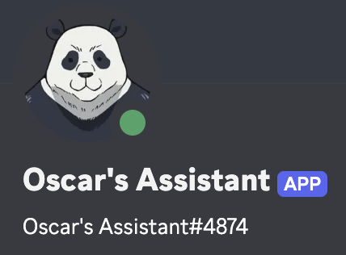

# panda-bot 🐼

**Oscar's** Discord AI agent, built from scratch with **Node.js** + **discord.js v14** and an **OpenRouter** tool-calling loop. No agent framework: the batching, memory, routing and safety rules below are all plain JavaScript in `src/`.



Panda can answer questions about itself: its `how_i_work` tool reads this README, so if you change how the bot works, update this file too.

## What it can do

- **Chat** when pinged, replied to, or mentioned by name, with several messages folded into one turn.
- **Remember** each server three ways: a recent transcript, a running summary, and a searchable message database.
- **See** images, PDFs, text files and GIFs posted in the conversation.
- **Search** the web and images through a private **SearXNG**, and read any public page.
- **Research** a question in depth: plan it, read pages, verify every claim against its source, and write a cited report.
- **Play music** in voice channels, from slash commands or plain chat ("play lofi").
- **Read GitHub** (repos, PRs, issues, commits, code search) through GitHub's MCP server (Oscar only).
- **Change its own code** and open PRs on other repos, in a GitHub Actions sandbox, behind an approval button (Oscar only).
- **React** with emoji instead of replying when words would be noise.
- **Private mode**: answer only Oscar.

## How a message becomes a reply

The flow lives in `src/discord/messageHandler.js` and `src/agent/agent.js`.

**1. Does Panda answer at all?**
- **Direct triggers** (always answered): an @-ping, or a reply to one of Panda's messages.
- **Mention-only triggers**: the message says "Panda" (`BOT_NAME`), "assistant", "bot" or "Oscar's" without a ping. Panda doesn't answer these automatically. **Jev** (below) decides whether the message is speaking to Panda, or whether people are talking about Panda in a way it should step in on. If not, Panda stays silent and nothing is saved.
- **DMs are turned off**: Panda ignores direct messages.
- **Private mode** on: anyone but Oscar gets a fixed "I am in a private conversation with Oscar right now." without the model being called. Other bots are ignored silently.
- **Self-fix running**: anyone who triggers Panda gets a fixed "rebuilding my own source code" message, once per person.

**2. Batching (the 3-second window).**
People often send a thought as three quick messages. The first trigger opens a **3-second batch** for that sender. Everything they send in those 3 seconds joins the batch, with or without a ping, and the timer does **not** reset. Another person's trigger during that time opens their own batch behind it.
- Each channel has a **FIFO queue** of batches, processed one at a time in arrival order. A queue holds at most **5** waiting batches; more triggers are dropped as spam.
- All channels of one server share one memory, so batches are also **serialized per server**. Two channels can never write the transcript at the same time.
- The reply goes to the **last** message of the batch, and the model is told it is one combined turn.

**3. Building the prompt.**
- **System prompt** (`src/agent/systemPrompt.js`): tone, Discord formatting rules, the react-or-reply rules, tool routing, security rules, and the persona files in `context/` (`IDENTITY.md`, `SOUL.md`, `USER.md`, plus any `context/memory/*.md`).
- **Long-term summary** of this server, if there is one.
- **Transcript**: the last ~40 stored messages of this server.
- **The new turn**, in two labelled blocks:
  - `[HISTORY CONTEXT]`: the **10 channel messages before the trigger** (Panda's own messages excluded), marked as background only.
  - `[RESPOND TO THIS]`: the batch itself. This is the task.
- Every message is written as `Name (@username, id:NNN): text`, with mentions as `@Name (id:NNN)`. The model always knows exactly who said what and can ping anyone with `<@id>` without a lookup.
- **Attachments** (`src/discord/attachments.js`) go to the model for this turn only:
  - Images, if the chat model accepts images (checked against OpenRouter's catalog), up to 5 MB.
  - PDFs, which OpenRouter parses for any model.
  - Text and code files up to 200 KB (first 20,000 characters).
  - The still frame of a Tenor/Giphy GIF.
  - Replying to someone's picture with "what's this?" sends that picture too.

**4. The agent loop.**
The model is called with all tools. Each tool call it makes is executed and the result fed back (capped at 12,000 characters), until it answers in plain text or hits `MAX_TOOL_ITERATIONS` (default 12). On a mention-only turn, Jev also suggests which tool to start with. When Jev is confident, the first call is forced to use it; later calls are free again.

**5. Sending the reply.**
- Embeds from tools (image results) go first, then the text.
- Long text is split at paragraph, line, sentence or word boundaries into Discord-sized messages, with code fences kept valid, 750 ms apart.
- Bare links are wrapped in `<>` so Discord doesn't unfurl them. Image URLs are left bare, because there the preview is the point.
- **A response is mandatory.** If the model produced neither text nor a reaction, Panda reacts 👀.
- The batch and Panda's reply are then saved to the message database. This happens after the reply is sent, so a slow database never delays it.

**6. Bot-to-bot loops.**
Two polite bots never stop on their own, so:
- Panda answers another bot at most **3 times in a row** per channel, then stays quiet until a human speaks.
- When a bot signs off ("bye!", "have a great day"), Panda reacts 👋 and stops instead of replying. Jev decides what counts as a sign-off; a regex is the fallback.

## Memory and context

Each server has its own memory, shared by all its channels and isolated from other servers. There are three layers, plus the persona files.

**1. Transcript (verbatim, short-term).**
Stored at `data/context/<serverId>.json` (`src/agent/contextStore.js`).
- Keeps the last **40 messages** word for word: user turns, Panda's answers, and tool calls with their results.
- Older messages are cut at a user-turn boundary, so a tool call is never separated from its result (the API rejects that).
- Only the turn itself is stored, never the `[HISTORY CONTEXT]` block. Storing it once filled the transcript with copies of itself. Old transcripts that still contain it are cleaned when loaded.
- Attachments are stored as their URL only.
- If the model call fails mid-turn, the question is still saved, so the next turn knows what was asked.

**2. Summary (compressed, long-term).**
Built in `src/agent/memory.js`.
- Messages that fall out of the 40-message window become **exchanges**: each question paired with the final answer Panda gave. Tool results and "let me look that up" messages are dropped; whatever mattered is already in the answer.
- Exchanges collect for free. Once **10** have piled up, the conversation model folds them into a summary of at most **1,500 characters**: who people are, decisions, facts, preferences, open tasks, promises. Greetings and bot pleasantries are dropped.
- The summary goes into every prompt as *"What you remember about this server"*.
- Summarising runs after the reply is sent, one at a time per server. If it fails, the exchanges are kept for next time.

**3. Message database (searchable, unlimited).**
Supabase Postgres (`src/agent/historyStore.js`, schema in `supabase/discord_history.sql`). Optional: without `SUPABASE_URL` and `SUPABASE_SECRET_KEY`, nothing is stored and the bot works the same otherwise.
- Every message in a batch, and every message Panda sends, is saved with its message id as the key. Saving a message twice just updates it.
- `/index_chat` (Oscar) saves a channel's entire history.
- The `fetch_history` tool searches it when someone refers to an older conversation ("what did we decide about the trip?"):
  - Messages in one channel are grouped into **conversations**, split at gaps over 30 minutes.
  - A keyword query (Postgres full-text search) returns the 3 best-matching conversations: 20 messages before each hit and 10 after.
  - No query returns the 3 most recent conversations.
  - Scope is this channel (default) or the whole server.
- The table has row-level security on and no policies, so only the bot's secret key can read or write it.

**Persona files.** `context/IDENTITY.md`, `SOUL.md` and `USER.md` set who Panda is, how it treats Oscar, and what may be shared about him. They are read once at startup.

**Forgetting.** `/clear` or the `clear_context` tool wipes this server's transcript and summary. `/clearall` or `clear_all_context` wipes every server. Both are Oscar only. The database is not touched by either.

## Models: OpenRouter and Jev

Every model call goes through one **OpenRouter** API key (`src/agent/openrouter.js`). Network errors, 429s and 5xx errors are retried up to 3 times with backoff.

| Role | Model | Used for |
|------|-------|----------|
| **Conversation** | `OPENROUTER_MODEL` | Every chat reply, memory summaries, `/research` stages |
| **Development** | `OPENROUTER_DEV_MODEL` | `self_fix` / `/run_dev`: the sandbox agent and commit messages |
| **Jev** | `typesafe/jev-1.13` | Fast yes/no and pick-one decisions |

- `/set_model` (Oscar) checks the id against OpenRouter's catalog (with autocomplete), writes it to `.env`, and restarts.
- `/set_dev_model` applies immediately and also writes to `.env`, so the choice survives a restart.
- `/model` shows the running model. `/usage` shows the key's spend (today, week, month, all-time) from OpenRouter.

**Jev** (`src/agent/jev.js`) is TypeSafe's decision model, called through OpenRouter's decisions endpoint with the same key. It doesn't write text: it gets a state and typed questions and returns **probabilities**, in about 0.2 s. Panda uses it for three things:

1. **Triage of mention-only messages.** Is this speaking to Panda? Should Panda step in? (≥ 0.8 to answer.) Which tool should it start with? (≥ 0.8 to force it.)
2. **Sign-off detection** for bot-to-bot conversations. It understands "aight gn" or a goodbye in another language, where a regex wouldn't.
3. **Fact-checking research**: does this quote actually support this claim? Claims it is fairly sure are unsupported (< 0.3) are dropped.

Jev is called only for messages that already mention Panda, and the 10 before them, so ordinary chat never leaves the server. Calls time out after 5 s. If Jev is off (`JEV_ENABLED=false`) or down, every caller falls back to its old behaviour: no answer to mention-only messages, the sign-off regex, and keeping all claims.

## Tools (what the model can call)

| Tool | What it does |
|------|--------------|
| `get_user_id` | Find a member's or bot's id by name, to ping them |
| `get_message_sender` | Who sent the current message |
| `react` | React with an emoji (alone, or alongside text) |
| `web_search` | Search the web via SearXNG; results cached 10 min |
| `web_fetch` | Read a public page as text |
| `image_search` | Google Images via SearXNG, max 3 results, shown as embeds |
| `fetch_history` | Search older conversations in the message database |
| `how_i_work` | Read this README to answer questions about Panda itself |
| `play_music` | play / skip / pause / resume / stop / queue / now playing |
| GitHub MCP tools | Read-only GitHub: files, code search, commits, PRs, issues, workflow runs (**Oscar only**) |
| `github` | GitHub REST API with Oscar's token (**Oscar only**) |
| `create_pr` | Development task on any repo, ending in a PR (**Oscar only**) |
| `self_fix` | Change Panda's own source, merge, restart (**Oscar only**) |
| `clear_context` / `clear_all_context` | Wipe memory for this server / every server (**Oscar only**) |

The "Oscar only" check is done in code against the sender's **Discord user id** (`OWNER_DISCORD_ID`), never against anything the message says. A guest asking for an owner tool just gets a refusal. The GitHub MCP tools aren't even offered to the model for guests.

## Slash commands

**🎵 Music:** `/play <song>`, `/skip`, `/pause`, `/resume`, `/stop`, `/queue`

**🧠 Skills:** `/research <query> [quick|normal|deep]`, `/web_search <query>`, `/web_fetch <url>`, `/image_search <query>`

**📖 Info:** `/menu`, `/usage`, `/model`

**🔒 Oscar only:**
- `/clear`, `/clearall`: wipe memory.
- `/index_chat`: save this channel's history to the database.
- `/self_fix <instruction>`, `/run_dev <instruction> [repo]`: development tasks.
- `/set_model <model>`, `/set_dev_model <model>`: switch models.
- `/private on|off|status`: private mode.
- `/github`: list Oscar's repos via the REST API.

## Deep research

`/research` (`src/agent/research/`) is a fixed pipeline. Plain JavaScript decides what to read, when to stop and what to drop. The model only answers one narrow question at a time, so even a cheap model gives a sourced report.

1. **Plan** the question into sub-questions, each with a search query.
2. **Search** them all in parallel through SearXNG.
3. **Pick pages**: never the same URL twice, at most 1–2 per domain.
4. **Read** up to 8 pages at once.
5. **Extract claims** from each page, each with a word-for-word quote. Code checks the quote really is on the page; Jev checks the quote really supports the claim.
6. **Fill gaps**: a sub-question that found nothing gets rewritten queries and another round (`deep` also tops up thin ones).
7. **Write**: remove duplicate facts, write one section per sub-question in parallel, then a direct answer to the question asked, with numbered sources.

| Depth | Sub-questions | Max pages | Extra gap rounds | Time limit |
|-------|---------------|-----------|------------------|------------|
| `quick` | 3 | 8 | 0 | 90 s |
| `normal` | 5 | 16 | 0 | 4 min |
| `deep` | 5 | 32 | 2 | 10 min |

Progress shows in the reply as it runs. If nothing could be verified, the report says so instead of making up an answer.

## The development sandbox (`self_fix`, `/run_dev`, `create_pr`)

These never edit the running bot. The flow:

1. **Approval.** Panda posts a card with **Approve** / **Cancel** buttons, showing the task and the development model. Only Oscar's click starts anything, and the card waits as long as needed. Cards left from before a restart lose their buttons when Panda boots.
2. **Dispatch.** Panda starts `.github/workflows/development-sandbox.yml`, which clones the target repo into a throwaway Actions runner.
3. **Agent loop.** The development model works through tools: `list_files`, `read_file`, `write_file`, `delete_file`, `finish`, plus read-only GitHub MCP tools for looking around.
   - It must read a file before writing it.
   - It can't touch `.git`, `node_modules`, `data/`, `.env` or `.github/`.
   - It has at most 40 steps.
   - A `finish` with nothing written is refused.
4. **Verify.** `node --check`, a check that every relative import resolves, `npm ci`, `npm test`. Then commit, push a `panda-dev-*` branch and open a PR. Every tool call is logged in the Actions run.

**`self_fix`** (Panda's own repo):
- The dev model writes the commit message (title starts with `🛠️ Self-fix: `).
- The PR gets **auto-merge**, and Panda waits for the merge.
- Then it exits with code 42. The supervisor (`start.sh`, generated by `run.sh`) runs `git pull` and restarts it on the new code.
- While it runs, everyone else gets the "rebuilding" message. The lock releases itself after 30 min.
- The run is recorded in `data/development-run.json`, so if Panda restarts mid-run it still reports the result to Oscar by DM.

**`/run_dev` / `create_pr`** (any repo): the tool returns once the PR is open. Oscar merges it by hand.

## Safety

- **Owner checks** use the sender's Discord user id, never names or claims in a message.
- **`web_fetch` can't reach private networks.** It refuses loopback, LAN, link-local and cloud-metadata addresses, checked on every DNS lookup and redirect. Without this, a page link could reach SearXNG or the router.
- **GitHub MCP** uses GitHub's `/readonly` endpoint, so chat can never write to a repo through it.
- **`.env` writes** from `/set_model` only accept safe model-id characters, and are written to a temp file then renamed, so a crash can't leave a half-written `.env`.

## Running it

**Local** (Node 22+):

```bash
cp .env.example .env
```

```bash
npm install
```

```bash
npm start
```

`npm start` runs `run.sh`. It starts a local SearXNG container (`scripts/ensure-searxng.sh`, which generates its secret on first run), then runs the bot under the `start.sh` supervisor:
- exit 42 → pull and restart
- crash → restart after 3 s
- exit 0 → stop

`npm run start:once` runs the bot once with no supervisor. `npm test` runs the test suite.

**Environment** (`.env`):

| Variable | Needed | Purpose |
|----------|--------|---------|
| `DISCORD_TOKEN` | ✅ | Bot token. Enable the Message Content intent (and Server Members for full `get_user_id`) |
| `OPENROUTER_API_KEY` | ✅ | Used for every model, including Jev |
| `OPENROUTER_MODEL` | | Conversation model |
| `OPENROUTER_DEV_MODEL` | | Development model |
| `OWNER_DISCORD_ID` | | Oscar's user id, which gates every owner-only feature |
| `JEV_ENABLED` | | `false` turns Jev off |
| `SEARXNG_URL` | | Default `http://127.0.0.1:8888` |
| `SUPABASE_URL`, `SUPABASE_SECRET_KEY` | | Message database; use the **secret** key, never the publishable one |
| `GITHUB_PAT` | | `github`, `create_pr`, `self_fix`, GitHub MCP |
| `GITHUB_MCP_ENABLED`, `GITHUB_MCP_URL` | | GitHub MCP switch and endpoint |
| `BOT_NAME`, `ALLOW_BOTS`, `MAX_TOOL_ITERATIONS` | | Name, whether bots can trigger Panda, tool-loop cap |
| `YT_COOKIES_FILE` / `YT_COOKIES_FROM_BROWSER` | | YouTube auth for reliable playback (`npm run yt-cookies` writes `cookies.txt`) |

**Message database:** run `supabase/discord_history.sql` on a Supabase project, then set the two `SUPABASE_*` variables.

**Music** uses `discord-player`. YouTube search goes through `youtubei.js` and the audio is streamed through the bundled `yt-dlp`, which is why cookies help.

## CI/CD and Docker

Every push to `main` builds a **Docker** image and publishes it to **Docker Hub** (`.github/workflows/docker.yml`) as `<username>/oscars-assistant-discord-bot`, tagged `latest` and with the commit SHA. Required repo secrets: `DOCKERHUB_USERNAME`, `DOCKERHUB_TOKEN`.

`docker-compose.deploy.yml` runs the bot and SearXNG together. Mount a volume on `/app/data` so transcripts, summaries and the private-mode flag survive restarts. The sandbox workflow needs the `OPENROUTER_API_KEY` Actions secret. Two more are optional:
- `PANDA_DEV_GITHUB_TOKEN`: lets it push to repos other than this one. Without it, the workflow's own token is used.
- `PANDA_MCP_PAT`: gives the sandbox agent the GitHub MCP tools.

## Project layout

```
src/index.js              boot, intents, slash-command registration
src/discord/              message handler (batching), slash commands, embeds, chunking
src/agent/agent.js        the tool-calling loop and Jev triage
src/agent/contextStore.js transcript + summary storage
src/agent/memory.js       exchanges → summary compaction
src/agent/historyStore.js Supabase message database
src/agent/jev.js          Jev decision calls
src/agent/tools/          every tool the model can call
src/agent/research/       the /research pipeline
src/music/                discord-player + yt-dlp streaming
context/                  persona files read into the system prompt
supabase/                 database schema
.github/                  Docker build and the development sandbox
```
